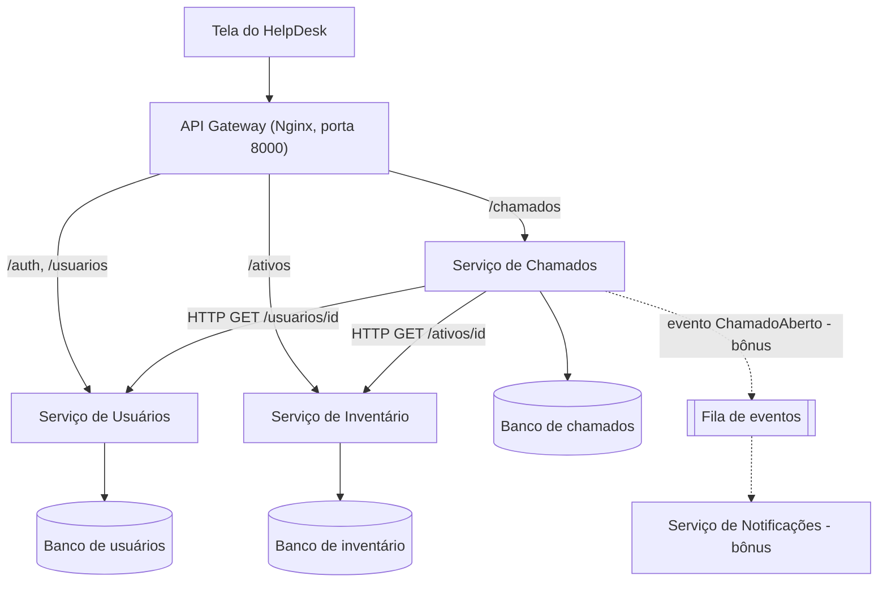

# HelpDesk TI — microsserviços

> 🎥 **Vídeo de demonstração:** COLE-AQUI-O-LINK-DO-VIDEO

Sistema de chamados de TI separado em três serviços (Usuários, Inventário e Chamados) atrás de um API Gateway.
Atividade de Arquitetura de Software (Prof. Filipe Cavalcante) — aluno: Samuel Tavares.

## Arquitetura



As linhas tracejadas são o bônus (ainda não feito).

## Como rodar

Pré-requisito: Docker Desktop aberto.

```
copy .env.example .env      # depois edite o .env e troque o JWT_SEGREDO (32+ caracteres)
docker compose up --build
```

Abra http://localhost:8000. Para ver os contêineres: `docker compose ps`.

Contas de exemplo (senha `Helpdesk2026`):

| E-mail | Perfil |
|---|---|
| carla@empresa.com | técnica |
| bruno@empresa.com | técnico |
| ana@empresa.com | solicitante |
| diego@empresa.com | solicitante |
| admin@empresa.com | admin |

## Serviços

| Serviço | Pasta | O que faz | Banco |
|---|---|---|---|
| Gateway | `gateway/` | Entrega a tela (`web/`) e encaminha cada rota | — |
| Usuários | `usuarios/` | Cadastro, login e emissão do token JWT | `usuarios_dados` |
| Inventário | `inventario/` | Equipamentos (`/ativos`) | `inventario_dados` |
| Chamados | `chamados/` | Abrir, atribuir, mudar status, comentar, painel (SLA e transições) | `chamados_dados` |

## Decisões

- **Um banco por serviço** (SQLite em um volume Docker para cada um). Nenhum serviço lê o banco de outro.
- **Sem chaves estrangeiras entre serviços.** Chamados guarda só `solicitante_id`, `tecnico_id` e `ativo_id` como números e confere pela rede quando precisa.
- **Comunicação por HTTP** com `httpx`, **timeout de 3 s** (`TIMEOUT_SEGUNDOS`). Se Usuários ou Inventário não respondem, Chamados devolve **503** com mensagem clara em vez de travar.
- **Token JWT** assinado em Usuários; **todo serviço valida o token** (mesmo `JWT_SEGREDO`, vindo do `.env`). O Chamados repassa o cabeçalho `Authorization` ao chamar os outros.
- **Identidade vem do token** (id e perfil), então Chamados e Inventário não consultam o banco de usuários. Consequência: se um usuário for desativado, o token dele continua valendo até expirar (60 min).
- **Gateway com Nginx**: simples e suficiente. Resolve o nome dos serviços a cada requisição, então sobe mesmo com um serviço parado.
- **Só o gateway publica porta.** Serviços e bancos ficam na rede interna do Docker. Contêineres sem root, sistema de arquivos somente leitura e sem privilégios extras.

## O que mudou em relação ao monólito

- Melhor: cada serviço pode ser publicado e escalado sozinho; uma falha em Inventário não derruba a lista de chamados.
- Mais difícil: agora existe rede no meio (latência, timeout, serviço fora do ar), não dá mais para usar chave estrangeira nem transação entre serviços, e o segredo do token precisa ser igual em todos.
