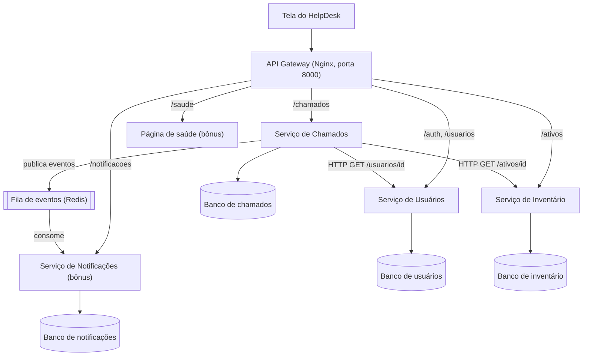

# HelpDesk TI — microsserviços

> 🎥 **Vídeo de demonstração:** COLE-AQUI-O-LINK-DO-VIDEO

Sistema de chamados de TI separado em quatro serviços (Usuários, Inventário, Chamados e Notificações) atrás de um API Gateway, com uma fila de eventos (Redis).
Atividade de Arquitetura de Software (Prof. Filipe Cavalcante) — aluno: Samuel Tavares.

## Arquitetura



Só o gateway é acessível de fora. Todo o resto fica na rede interna do Docker.

## Como rodar

Pré-requisito: Docker Desktop aberto.

```
copy .env.example .env      # depois edite o .env e troque o JWT_SEGREDO (32+ caracteres)
docker compose up --build
```

Abra http://localhost:8000. Para ver os contêineres: `docker compose ps`.

Contas de exemplo (senha `Helpdesk2026`):

| E-mail | Perfil |
|---|---|
| carla@empresa.com | técnica |
| bruno@empresa.com | técnico |
| ana@empresa.com | solicitante |
| diego@empresa.com | solicitante |
| admin@empresa.com | admin |

## Serviços

| Serviço | Pasta | O que faz | Banco |
|---|---|---|---|
| Gateway | `gateway/` | Entrega a tela (`web/`) e encaminha cada rota | — |
| Usuários | `usuarios/` | Cadastro, login e emissão do token JWT | `usuarios_dados` |
| Inventário | `inventario/` | Equipamentos (`/ativos`) | `inventario_dados` |
| Chamados | `chamados/` | Abrir, atribuir, mudar status, comentar, painel (SLA e transições) | `chamados_dados` |
| Notificações (bônus) | `notificacoes/` | Lê os eventos da fila e mostra os avisos de cada usuário (`/notificacoes`) | `notificacoes_dados` |
| Fila (bônus) | imagem `redis:7-alpine` | Guarda os eventos entre Chamados e Notificações | `redis_dados` |

## Decisões

- **Um banco por serviço** (SQLite em um volume Docker para cada um). Nenhum serviço lê o banco de outro.
- **Sem chaves estrangeiras entre serviços.** Chamados guarda só `solicitante_id`, `tecnico_id` e `ativo_id` como números e confere pela rede quando precisa.
- **Comunicação por HTTP** com `httpx`, **timeout de 3 s** (`TIMEOUT_SEGUNDOS`). Se Usuários ou Inventário não respondem, Chamados devolve **503** com mensagem clara em vez de travar.
- **Token JWT** assinado em Usuários; **todo serviço valida o token** (mesmo `JWT_SEGREDO`, vindo do `.env`). O Chamados repassa o cabeçalho `Authorization` ao chamar os outros.
- **Identidade vem do token** (id e perfil), então Chamados e Inventário não consultam o banco de usuários. Consequência: se um usuário for desativado, o token dele continua valendo até expirar (60 min).
- **Gateway com Nginx**: simples e suficiente. Resolve o nome dos serviços a cada requisição, então sobe mesmo com um serviço parado.
- **Fila com Redis (lista, `LPUSH`/`BRPOP`)**: simples e suficiente; o evento espera na fila se o consumidor estiver parado. Limitação: se o consumidor cair no meio de um evento, ele pode se perder (um sistema de produção usaria confirmação de entrega, como RabbitMQ).
- **Só o gateway publica porta.** Serviços e bancos ficam na rede interna do Docker. Contêineres sem root, sistema de arquivos somente leitura e sem privilégios extras.

## Bônus

**1. Notificações por fila de eventos.** Quando um chamado é aberto, atribuído ou resolvido, o serviço de Chamados publica um evento (`ChamadoAberto`, `ChamadoAtribuido`, `ChamadoResolvido`) numa fila do Redis. O serviço de Notificações lê a fila, grava o aviso no banco dele e a tela mostra em "Minhas notificações". Cada usuário só vê os próprios avisos (o id vem do token).
Se o Redis ou o serviço de Notificações estiver fora do ar, **o chamado abre normalmente**: Chamados só registra um aviso no log e segue. Os eventos que já estão na fila são processados quando o serviço volta.

**2. Testes por serviço no GitHub Actions.** Cada serviço tem a sua pasta `tests/` (usuários 18, inventário 12, chamados 30 e notificações 9 testes), incluindo os testes de segurança adaptados (sem token, token inválido, expirado, assinado com outro segredo, permissões por perfil, chamada entre serviços com timeout e 503). O workflow `.github/workflows/testes.yml` roda os quatro em paralelo a cada push.
Para rodar um serviço localmente, sem instalar Python (exemplo com `usuarios`):

```
docker run --rm -v "${PWD}\usuarios:/work" -w /work python:3.12-slim sh -c "pip install -q -r requirements-dev.txt && pytest -q -p no:cacheprovider"
```

**3. Rota de saúde.** Cada serviço responde `GET /saude`. No gateway, `http://localhost:8000/saude` mostra uma página com quais serviços estão no ar (atualiza a cada 3 s), e `/saude/<serviço>` devolve o JSON de cada um. Se um serviço estiver parado, a linha dele fica "fora do ar".

## O que mudou em relação ao monólito

- Melhor: cada serviço pode ser publicado e escalado sozinho; uma falha em Inventário não derruba a lista de chamados.
- Mais difícil: agora existe rede no meio (latência, timeout, serviço fora do ar), não dá mais para usar chave estrangeira nem transação entre serviços, e o segredo do token precisa ser igual em todos.
